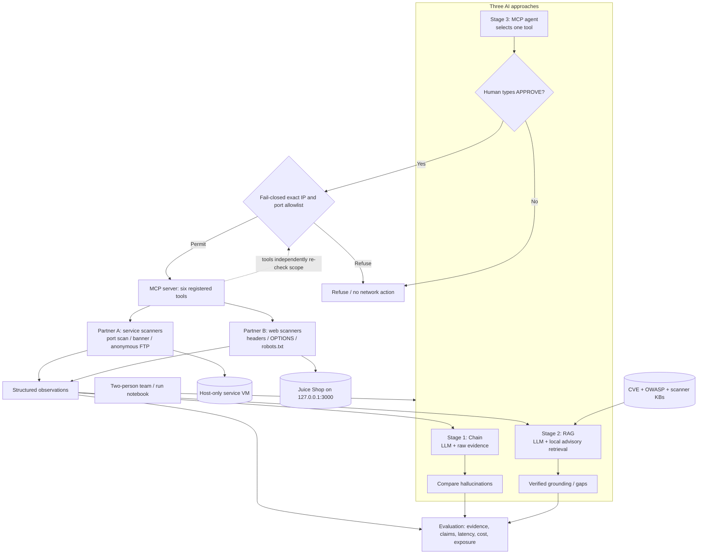

# AI Security Analyst for Your Own Lab

**Applied AI in Cybersecurity | Final Capstone | Two Partners**

Build an isolated vulnerable lab, write real **non-exploitative reconnaissance**
functions, expose six scanners as MCP tools, and evaluate the progression from
**Chain → Retrieval-Augmented Generation (RAG) → Human-Gated MCP Agent**. Compare
a **hosted open-weight LLM** with a **paid API model** using reproducible evidence.
The system never scans an unapproved destination or executes an AI-proposed
network action without an explicit typed `APPROVE`.

> **Status:** executable source, automated tests, and a notebook scaffold are
> provided. Live lab outputs, API runs, reviewer validation, private GitHub URL,
> signatures, report PDF and recorded video must be produced by the two students.
> Never treat sample instructor files or KB matches as observed vulnerabilities.

## 1. Architecture



**Trust boundaries:** model output is a *proposal*, not authorization; untrusted
scanner responses are data, not commands. Every scanner validates the allowlist
again before any socket or HTTP request. HTTP redirects are never followed.

## 2. Directory map

```text
final_project/
├── README.md, .env.example, .gitignore, requirements.txt, SOURCES.md
├── CONTRIBUTIONS.md, cli.py
├── reference/           # Original instructor notebooks and MCP server examples
├── labs/                # Host-only service VM + localhost Juice Shop Docker compose
├── schemas/             # Shared JSON-friendly security finding format
├── scanners/
│   ├── service/          # port_scanner, banner_grabber, ftp_checker
│   └── web/              # security_headers, http_methods, robots_checker
├── guardrails/           # Exact target allowlist, per-action typed APPROVE
├── mcp_tools/            # Unified FastMCP server and stdio client
├── knowledge_base/      # CVE KB, OWASP KB, scanner guidance, retrieval loader
├── agent/               # Stage 1 Chain, Stage 2 RAG, Stage 3 gated MCP agent
├── models/              # Hosted vs paid API OpenAI-compatible adapters
├── evaluation/          # Coverage, stages, live model latency / cost accounting
├── tests/               # Offline scope/approval/scanner tests
├── notebooks/           # Run notebook (save outputs for assessment)
├── results/             # Real scans, model reports, measured metrics
└── docs/                # Architecture, report template, video outline
```

Most subfolders contain their own README. The original starter files remain
unchanged in `reference/` so you can trace course concepts to implementation.

## 3. Prerequisites

- Python **3.11+**, `pip`, and **Docker** for OWASP Juice Shop.
- A local x86 VM + VirtualBox/VMware host-only adapter for **Metasploitable 2**,
  or an approved vulnerable service image. No internet-exposed lab machines.
- A self-hosted 14B-class open-weight model on **Jetstream2**, or largest feasible
  local model if Jetstream2 is unavailable; expose an OpenAI-compatible API.
- A separately paid **API LLM** and appropriate credentials.
- The instructor and TA added as collaborators to your **private course repo**.

## 4. Setup

From inside `final_project/`:

```bash
python3 -m venv .venv
source .venv/bin/activate           # Windows: .venv\Scripts\activate
python -m pip install -r requirements.txt
cp .env.example .env                # Edit only .env; DO NOT commit keys
python -m pytest -q
```

Start the web lab **on the same computer where the scanner runs**:

```bash
docker compose -f labs/web_lab/compose.yaml up -d
# Confirm http://127.0.0.1:3000 is accessible locally
```

Start the service VM in a **host-only** network. Replace the example service
address in `guardrails/targets.json` with its actual host-only IP. Only listed
literal IPs and ports are permitted. Do **not** add arbitrary internet targets.

## 5. Collect authentic scanner evidence

The CLI asks for *fresh typed APPROVE* before each action:

```bash
# Partner B: three live web tools against the local container
python cli.py --mode collect --domain web --target http://127.0.0.1:3000

# Partner A: three real service tools against YOUR actual host-only VM
python cli.py --mode collect --domain service --target 192.168.56.101 --ports 21,22,80
```

The above service IP is only a **configuration example**—replace it after
verifying your lab. Results save to `results/web_scans/live_findings.json` and
`results/service_scans/live_findings.json`. Open and validate those JSON files.
Connection failures and service banners are observations, not proof of a CVE.

## 6. Compare stages and models

Configure `HOSTED_BASE_URL`, `HOSTED_MODEL`, `API_BASE_URL`, `API_MODEL` and
`API_API_KEY` in `.env`. Host your open-weight model via Ollama/vLLM. If the
GPU machine is remote, use an SSH port-forward to a **loopback** endpoint and
keep Jetstream2's public firewall closed.

```bash
# Inspect retrieved KB candidates (no LLM needed)
python cli.py --mode evidence --domain web

# Stage 1: same collected findings, no KB in model context
python cli.py --mode chain --domain web --model HOSTED
python cli.py --mode chain --domain web --model API

# Stage 2: retrieved KB excerpts and citation instructions
python cli.py --mode rag --domain web --model HOSTED
python cli.py --mode rag --domain web --model API

# Repeat both stages for the service domain
python cli.py --mode chain --domain service --model HOSTED
python cli.py --mode rag --domain service --model API

# Stage 3: ask an LLM to propose one MCP tool and require human approval
python cli.py --mode agent --model HOSTED --objective \
  "Inspect HTTP security headers on http://127.0.0.1:3000"
```

The Stage 3 agent proposes **one action at a time**. MCP calls require a server-checked single-use approval token bound to the exact action; direct MCP clients without valid tokens are rejected. Re-run for another step.
MCP tool invocation is real (stdio, child process); it is *not* the simulated
instructor MCP server. An out-of-scope address is rejected before the approval
prompt and rechecked again inside the MCP scanner. Results are written to JSON.

## 7. Jupyter notebook

Run `notebooks/final_project.ipynb` from the repository root and execute the
cells in order, with actual lab targets and model settings. The notebook shows
scope/approval checks, live scanner collection, grounding candidates, and calls
into the two live model backends. Save all outputs before submitting. Do not
mistake examples in `reference/` for completed lab experiments.

## 8. Evidence, grading and scientific integrity

| Required rubric element | Where to show it |
|---|---|
| Two labs and real scanner outputs | `labs/`, `results/*_scans/`, notebook |
| Three scanners per side | `scanners/service/`, `scanners/web/`, MCP server |
| Three stages for EACH partner | `agent/`, notebook, saved per-side reports |
| KB growth, cited remediation, grounded/gap classification | `knowledge_base/`, `SOURCES.md`, reviewer tables |
| Allowlist and typed approval refusal | `guardrails/`, tests, live notebook/video |
| One MCP agent over both toolsets | `mcp_tools/`, `agent/security_agent.py` |
| Hosted versus API comparison | `models/`, `evaluation/`, result metrics |
| Report, video and two signed contributions | `docs/`, `CONTRIBUTIONS.md` |

**Evaluation:** Count a claim as grounded only after manual verification of
both the observed evidence and the cited advisory. Record accuracy, latency,
actual paid token cost, private-vs-third-party data transmission and failures.
An AI-suggested CVE is a hypothesis until confirmed by an authoritative source.

## 9. Safety and ethics

- Only inspect the privately owned **local lab**; never scan arbitrary hosts.
- Host-only service VM, localhost-only Docker binding, no open Jetstream2 ports.
- No exploitation, credential guessing, brute forcing or file modification.
- Change or validate targets before use; default placeholder VM IP is not proof
  that the target belongs to you.
- Approval is typed separately per executable action. Never store real secrets.
- Scanner outputs, retrieved guidance and agent proposals are untrusted.

## 10. Submission checklist

1. Run the tests and live scanners; sanitize then commit actual notebook outputs.
2. Execute both model backends and three stages; manually validate citations.
3. Complete the **8–12-page report PDF** from `docs/report_template.md`, naming
   both partners, repository URL and video URL on page one.
4. Record a **12–18-minute** demo with both partners speaking, a successful MCP
   execution, refused out-of-scope scan and denied approval.
5. Complete `CONTRIBUTIONS.md` honestly with both signatures and commit links.
6. Keep repository private and invite the instructor and TA. Submit one team PDF.

**Course learning outcomes:** this capstone connects model prompting, RAG,
agentic tool orchestration, explainable evidence-based triage, security
engineering and human-in-the-loop safety controls in a reproducible lab.
